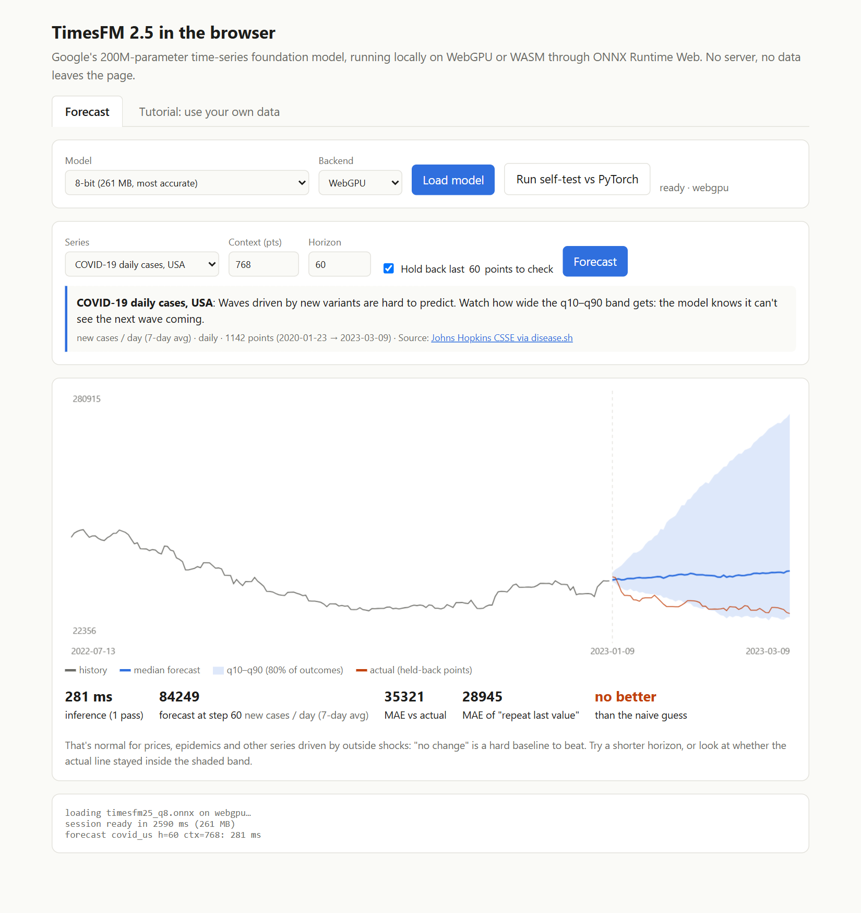
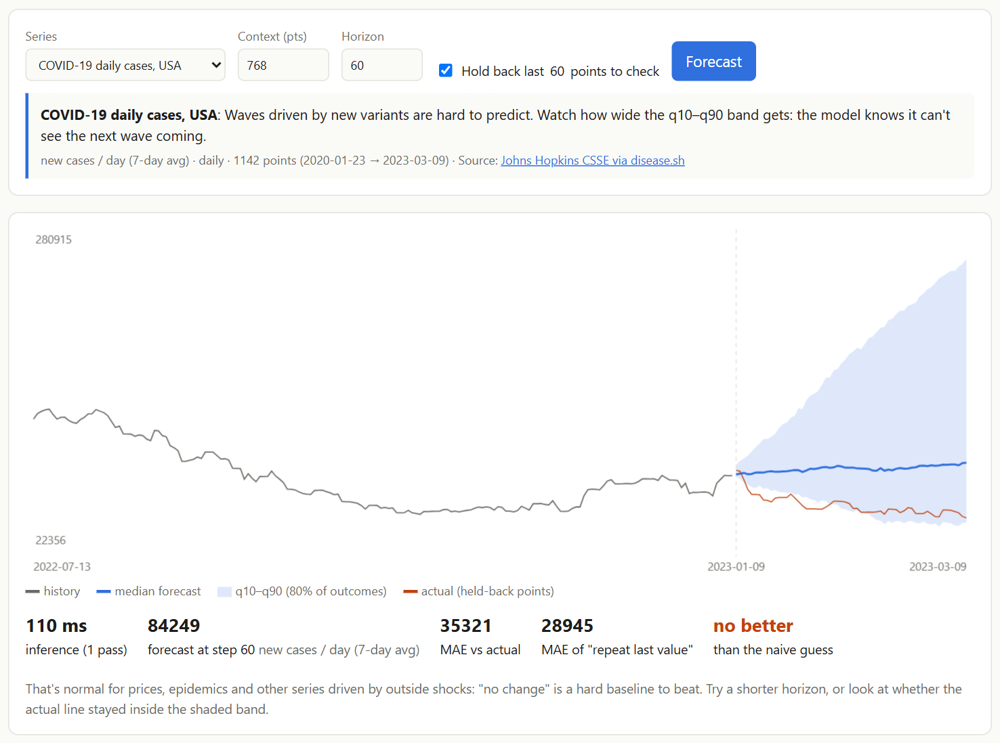
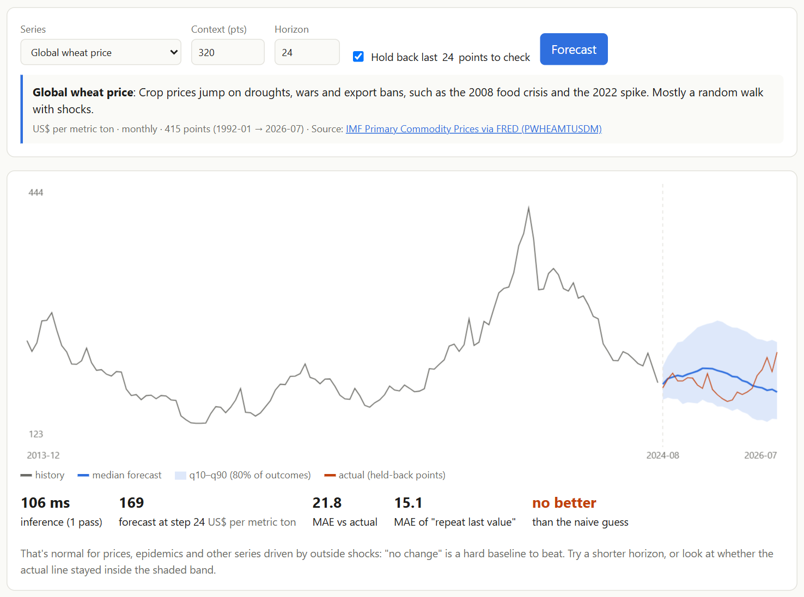
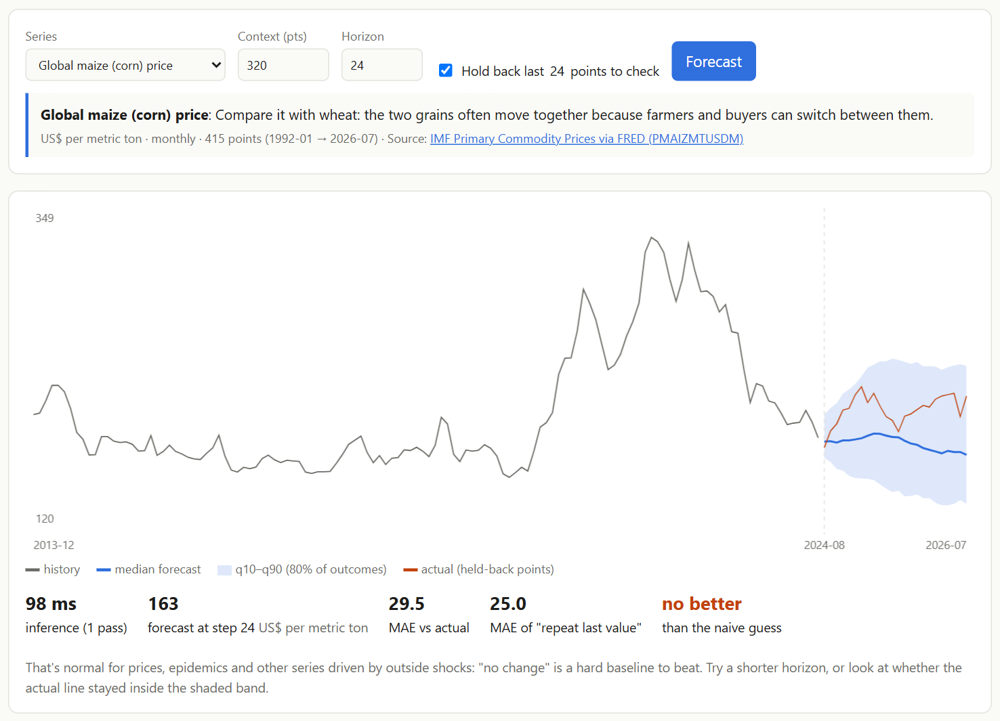
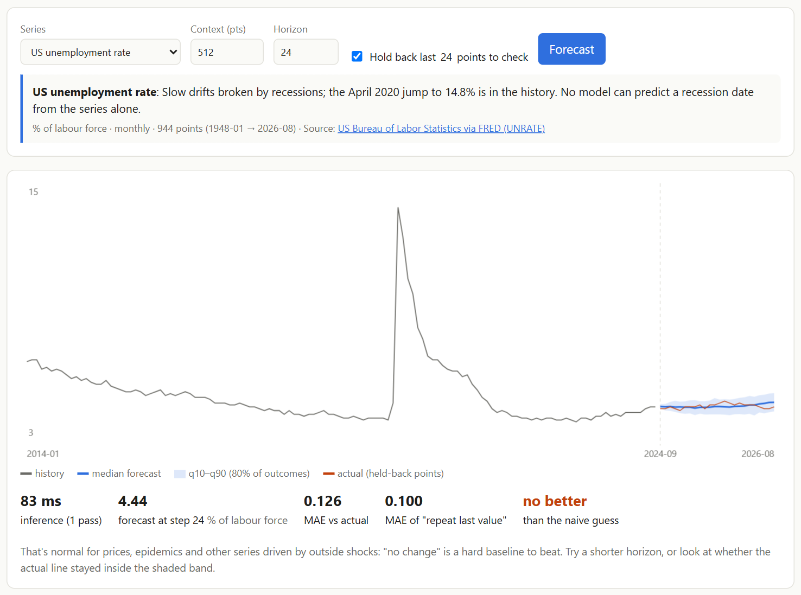
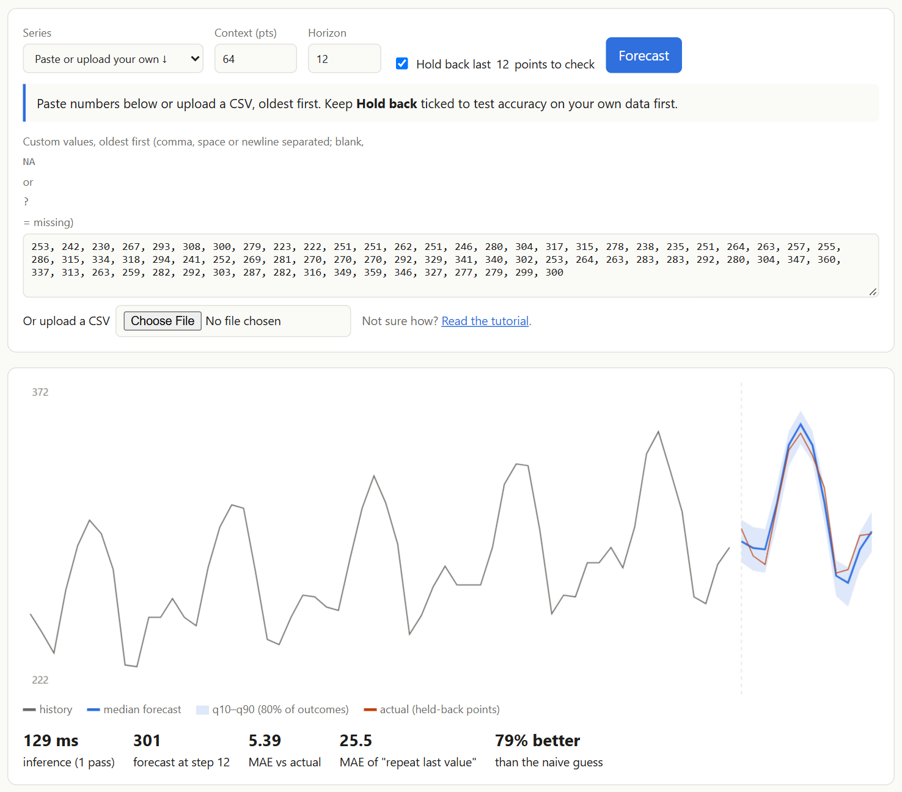

# Forecast Anything in Your Browser: Google's TimesFM 2.5 on COVID, Poverty, Farming and More

*A 200-million-parameter time-series foundation model that runs entirely on your own computer. There's no server or sign-up, and your data never leaves the page.*

**Try it:** https://vishalmysore.github.io/webTimesFM/
**Code:** https://github.com/vishalmysore/webTimesFM
**Model files:** https://huggingface.co/VishalMysore/timesfm-2.5-200m-onnx-web



---

## The problem: forecasting is useful, but the tools are out of reach

Almost everything we measure is a time series: daily hospital admissions, monthly electricity bills, crop prices, rainfall, shop sales, website visits. "What happens next?" is one of the most common questions anyone asks about data.

Getting a decent answer has usually meant one of two things:

- **Build a model yourself:** pick ARIMA, Prophet or a neural network, tune it on your data, and maintain it. That needs a data scientist.
- **Upload your data to a cloud service:** fine for some data, but not for a clinic's patient counts or a small business's sales.

**Time-series foundation models** change the first part. Google Research's **TimesFM** was pre-trained on about 100 billion real-world time points, so it already understands trends, seasons and cycles. You give it a list of numbers and it forecasts the next ones, with **no training on your data**. Researchers call this "zero-shot" forecasting.

This project fixes the second part: it runs that model **inside your web browser**.

## The idea: put the model where the data is

webTimesFM runs **TimesFM 2.5 (200M)**, Google's open model, entirely client-side:

- The model is converted to **ONNX**, a portable model format, and runs on **ONNX Runtime Web**.
- It uses your graphics card through **WebGPU** when available, and falls back to the CPU (**WASM**) otherwise.
- The model file downloads once from Hugging Face and is then cached by the browser.
- Your numbers never leave the tab. There's no backend at all, and the website is just two static files on GitHub Pages.

A forecast of 128 steps takes **well under a second** on a laptop GPU, typically 50–300 milliseconds.

### Two model sizes to choose from


To make a 200M-parameter model practical to download, its weights are compressed ("quantized"):

| Model | Download | How close to Google's original |
|---|---|---|
| **8-bit** (default) | 261 MB | Practically identical: off by about a tenth of the series' normal step size |
| **4-bit** | 146 MB | Fine on long histories, but can drift on short series (under ~64 points) |

Put simply, if your savings normally grow by ₹100 a month, the 8-bit model's forecast sits within about ₹10 of Google's full-size model. The 4-bit model is usually close too, but on very short histories it can be off by several hundred rupees. That's why 8-bit is the default.

The page also has a **Run self-test vs PyTorch** button. It checks the browser model against forecasts made by Google's own Python code, right on your machine:


---

## How it works, in plain words

1. **You give it a list of numbers** in time order, one per day, week, month or year.
2. The numbers are cut into **patches of 32 points** and rescaled, so units don't matter: rupees, tonnes, °C and % all work the same.
3. The transformer reads the patches and predicts the **next 128 values at once**, each with **10 quantiles**: a best guess plus a range of likely outcomes. For longer horizons it feeds its forecast back in and goes again.
4. The page draws the **median forecast** (blue line) and the **10%–90% band** (shaded). The model expects about 8 in 10 future values to land inside the band.

### "Was it any good?" is built in

Every example has a **Hold back** option. The page hides the most recent stretch of data from the model, forecasts it, then draws what really happened in orange. It scores the forecast against the simplest possible guess, **"it stays where it was last"**. If a fancy model can't beat that, you should know.

---

## Seven real-world examples

All data comes from public sources and is linked on the page. Each chart below is a real forecast run in the browser with the 8-bit model.

### Climate: CO₂ at Mauna Loa, 95% better than "no change"


Carbon dioxide in the atmosphere rises steadily, with a yearly "breathing" cycle as northern-hemisphere plants grow in summer and decay in winter. Given data up to September 2021, TimesFM forecast the next **five years** almost exactly. It caught both the climb and every seasonal wiggle. The average miss is **0.56 ppm**, against 10.2 ppm for "no change".

**Takeaway:** when a series has a strong, regular pattern, a foundation model nails it with zero setup.

### Science: Sunspots, catching the next solar cycle


Sunspots rise and fall on a roughly **11-year cycle**. The model read 1,024 months of history, then forecast **ten years ahead**, from late 2016. It predicted the quiet minimum, then a new cycle rising and peaking, and it got the size of the peak about right. The real peak came a little later than forecast, but the shape is unmistakable. It was **15% better** than "no change" over a full decade.

### Health: COVID-19 daily cases in the USA, an honest "I don't know"



COVID waves were driven by new variants and changes in behaviour, which no amount of past case counts can reveal in advance. Here the forecast's median line misses, and it does worse than "no change". But look at the **shaded band**: it fans out widely, and the real values run along its lower edge. The model is effectively saying "cases could go anywhere from here", and that's the correct answer.

**Takeaway:** for shock-driven series, the range is more useful than the single line.

### Society: World extreme poverty, when the world changes the rules


The share of people living on under $3 a day (World Bank) fell for decades: from 47% in 1981 to 11% in 2018. Hiding 2020–2024, the model sees that steady fall and expects it to continue. Reality, the orange line, shows **COVID-19 stalling progress in 2020**. The real values sit at the top edge of the band.

This is the clearest example of what a pure pattern model can't know: a global pandemic is not in the poverty numbers until it happens. It's also a short series, only 38 yearly points before the cut-off, which is exactly where the 8-bit model matters.

### Farming: Global wheat and maize prices



Grain prices jump on droughts, wars and export bans, such as the 2008 food crisis and the spike after Russia's invasion of Ukraine in 2022. Between shocks they wander like a random walk. Over the hidden two years (Aug 2024 – Jul 2026), the forecast stays inside a sensible band and the real prices mostly stay inside it too. But "no change" is hard to beat for prices, and TimesFM doesn't beat it here.



Maize (corn) tells the same story. The two grains often move together, because farmers and buyers can switch between them.

### Economy: US unemployment rate



Unemployment drifts slowly and then jumps in recessions; the April 2020 spike to 14.8% is in the history. Over the hidden two years the rate barely moved, so "no change" wins narrowly (0.13 vs 0.10 points). Nothing in the series alone can tell you when the next recession comes.

### Scorecard

| Example | Model's average miss | "No change" miss | Result |
|---|---|---|---|
| CO₂ (60 months) | 0.56 ppm | 10.2 ppm | **95% better** |
| Sunspots (120 months) | 42.5 | 50.1 | **15% better** |
| US unemployment (24 months) | 0.13 pts | 0.10 pts | no better |
| Maize price (24 months) | $29.5/t | $25.0/t | no better |
| Wheat price (24 months) | $21.8/t | $15.1/t | no better |
| World poverty (5 years) | 1.88 pts | 0.46 pts | no better (COVID shock) |
| US COVID-19 cases (60 days) | 35,321/day | 28,945/day | no better (band covers reality) |

The page doesn't pick test windows to flatter the model. When TimesFM loses, it says so and explains why.

---

## Try it with your own data


The **Tutorial** tab walks through it step by step:

- **What makes a good series:** evenly spaced, oldest first, one number per step. Gaps are fine: leave a blank or write `NA`.
- **Getting data in:** paste a column from Excel or Google Sheets, or **upload a CSV** and pick the column.
- **Choosing context and horizon:** how much history to show it, and how far ahead to predict.
- **Checking accuracy:** with Hold back, and reading the band.
- **Where to find data:** World Bank, FRED, Our World in Data, FAOSTAT, data.gov.in, or your own meter readings and sales.

There are also four **practice datasets**: a home electricity bill, a village rice harvest, weekly flu visits at a clinic and a corner shop's daily sales. They're made-up but realistic, and each loads with one click. For example, the electricity bill, with its summer AC peak and slow rise:



TimesFM forecast the next year at **79% better** than "no change", with zero tuning.

---

## Where this is useful

- **Small businesses:** forecast next month's sales or stock needs from a spreadsheet column, privately.
- **Farmers and co-operatives:** look at seasonal price patterns and yields, and see how uncertain the outlook is.
- **Clinics and public-health teams:** plan staffing around seasonal patterns like flu, without sending patient counts anywhere.
- **Households:** electricity, water and fuel bills.
- **Teachers and students:** a hands-on way to learn about trends, seasonality, uncertainty and baselines with real public data.
- **Developers:** `timesfm.js` is a small drop-in library. Load the model from Hugging Face and call `model.forecast(numbers, horizon)` in your own page.

## Limits, plainly

- **It only sees the numbers.** Pandemics, wars, policy changes and recessions are invisible until they show up in the data.
- **One series at a time.** It can't use rainfall to predict crop prices.
- **Prices and other random walks are hard.** "No change" is a strong baseline, and the honest answer there is the band, not the line.
- **It's a demo, not advice.** Compare it with simple baselines and domain knowledge before acting on it.

---

## Next idea: let a language model read the news

The examples above point to an obvious next step. The model failed exactly where **the news** carried the signal: new COVID variants, the Ukraine war for grain prices, the pandemic for poverty.

A browser language model through **WebLLM** could fill that gap, with each model doing what it's good at:

```
News headline ──► WebLLM ──► structured event              ──►┐
                             {direction: up,                   │
                              strength: large,                 ├──► TimesFM forecast
                              duration: 3–6 months}            │    + "what-if" band
Numbers ──────────────────────────────────────────────────►───┘
```

- **WebLLM** reads a headline and turns it into a simple, structured event: which direction, how strong and for how long. It never invents exact numbers; small language models are poor at arithmetic.
- **TimesFM** keeps doing the number forecasting.
- The page would show a second, clearly labelled **"what-if" band** next to the normal forecast. A lighter version would simply have the LLM explain what the forecast assumes ("this assumes no shock; note the export ban announced last week").

Two things would need care to keep it honest:

1. **Hindsight.** Language models were trained on text that already describes COVID and the 2022 grain spike. Tested on the past, they'd *remember* the answer rather than predict it. A fair test feeds the model only headlines dated before the forecast point, and uses events after the LLM's training cutoff.
2. **Timing.** News only helps when it arrives before the numbers move. Variant news came weeks before case surges, but the Ukraine invasion moved wheat prices within days.

It's an idea for a future version and isn't built yet.

---

## Related project: forecasting the 2026 World Cup with TimesFM

This isn't the first time I've pointed a TimesFM model at a real question in the browser. In **[webForecast](https://github.com/vishalmysore/webForecast)** I ran a smaller, **70M-parameter TimesFM** (Fareed Khan's from-scratch build) on WebGPU and used it to estimate **who would win the 2026 FIFA World Cup**.

A forecaster can't answer "who wins a tournament" directly, so that project reframed the question in two stages:

1. **TimesFM** forecast each team's **Elo rating** (a strength score built from 49,000 international matches since 1872), including an uncertainty band.
2. A football **match model** (Dixon–Coles, a Poisson goals model) and a **Monte-Carlo simulation of the real 48-team format**, with groups, best third-placed teams and the knockout bracket, turned those strengths into each team's chance of lifting the trophy.

It ran 50,000 simulated tournaments in about 1.3 seconds, all in the browser. Read it here: **[Forecasting the 2026 World Cup in Your Browser](https://github.com/vishalmysore/webForecast/blob/main/article_soccer.md)**, or try the [live demo](https://vishalmysore.github.io/webForecast/wc/).

The two projects make a nice pair:

| | webForecast (World Cup) | webTimesFM (this project) |
|---|---|---|
| Model | TimesFM, 70M from-scratch build | Google's official TimesFM 2.5, 200M |
| Download | 65 MB | 261 MB (8-bit) or 146 MB (4-bit) |
| Question | Who wins the World Cup? | Anything you can measure over time |
| Approach | Forecast feeds a simulation | Direct forecast with an accuracy check |

Both show the same thing: time-series foundation models are now small and fast enough to run in an ordinary browser tab.

---

## Try it

1. Open **https://vishalmysore.github.io/webTimesFM/**.
2. Click **Load model**. It's a one-time 261 MB download, then cached.
3. Pick an example and click **Forecast**, or paste your own numbers.

Everything runs on your machine. Close the tab and nothing is left on a server, because there isn't one.

---

*Credits: TimesFM is by Google Research ([paper](https://arxiv.org/abs/2310.10688), [code](https://github.com/google-research/timesfm), [weights](https://huggingface.co/google/timesfm-2.5-200m-pytorch)), Apache-2.0. This browser version is an unofficial community conversion and isn't endorsed by Google. Data: Johns Hopkins CSSE, World Bank, IMF via FRED, US Bureau of Labor Statistics, NOAA Global Monitoring Laboratory and SILSO / Royal Observatory of Belgium.*

---

## Disclaimer

**Please read before using the forecasts on this site or in this article.**

### Not affiliated with Google
- **TimesFM** is created by **Google Research**: [paper](https://arxiv.org/abs/2310.10688), [code](https://github.com/google-research/timesfm), [TimesFM 2.5 weights](https://huggingface.co/google/timesfm-2.5-200m-pytorch). "Google" and "TimesFM" are names and trademarks of Google LLC.
- **webTimesFM** is an **independent, unofficial community project**. It is not made, sponsored, reviewed or endorsed by Google, and nothing here speaks for Google.

### About the browser model
- The model running here is a **conversion** of Google's TimesFM 2.5 weights to ONNX, compressed to 8-bit and 4-bit. The weights' values come only from Google's release; they were not retrained or fine-tuned.
- Compression and the browser re-implementation of the pre- and post-processing mean its forecasts **can differ slightly** from Google's official code. The 4-bit model differs more, especially on short series. Use the **Run self-test vs PyTorch** button to check on your own machine.
- TimesFM 2.5 code and weights are licensed under **Apache-2.0** and are provided **"as is", without warranties or conditions of any kind**. The changes made for this conversion are listed on the [model card](https://huggingface.co/VishalMysore/timesfm-2.5-200m-onnx-web). TimesFM 3.0, which has a separate non-commercial licence, is **not** used or included.

### Not financial, investment or betting advice
- The oil, Bitcoin and other price forecasts are **educational demonstrations**, not recommendations to buy, sell or hold anything. Prices behave much like a random walk, and in our own tests the model roughly ties a simple "no change" guess.
- The World Series odds are an **illustration of a forecasting method**, not betting tips. They ignore starting pitchers, injuries and much else that matters.
- Forecasts can be, and often are, **wrong**. Past accuracy doesn't guarantee future results. Don't make financial, betting, business, medical or policy decisions based on this site. Consult a qualified professional instead.

### About the data and the news signal
- Data comes from **third-party public sources**: MLB Stats API, FRED (Federal Reserve Bank of St. Louis), IMF, World Bank, US Bureau of Labor Statistics, NOAA, SILSO / Royal Observatory of Belgium, Johns Hopkins CSSE and Google News. Each is subject to its own terms and is used here for **non-commercial, educational purposes**.
- Data can be **delayed, revised or incomplete**. For example, official oil prices lag the market by about a week. It's refreshed automatically once a day, with no manual checking, and accuracy isn't guaranteed.
- News headlines belong to their **publishers** and are linked, not copied in full. The news tone is scored **automatically** by a simple sentiment model (VADER). It can misread sarcasm, context or mixed stories, and it isn't an editorial judgement about any team, company or event.
- Team and league names are trademarks of their respective owners. This project isn't affiliated with or endorsed by Major League Baseball or any team.

### Privacy
- Forecasts run **entirely in your browser**. Numbers you paste or upload aren't sent to any server by this site.
- Your browser does download files from third parties: the model from **Hugging Face**, and ONNX Runtime from the **jsDelivr** CDN. Those services may log the request, as any website does.

### Use at your own risk
This is a free, open-source demonstration for learning and research. It's provided **as is**, with no warranty of any kind. The author isn't liable for any loss or damage arising from its use. Always verify important numbers with the original sources.
