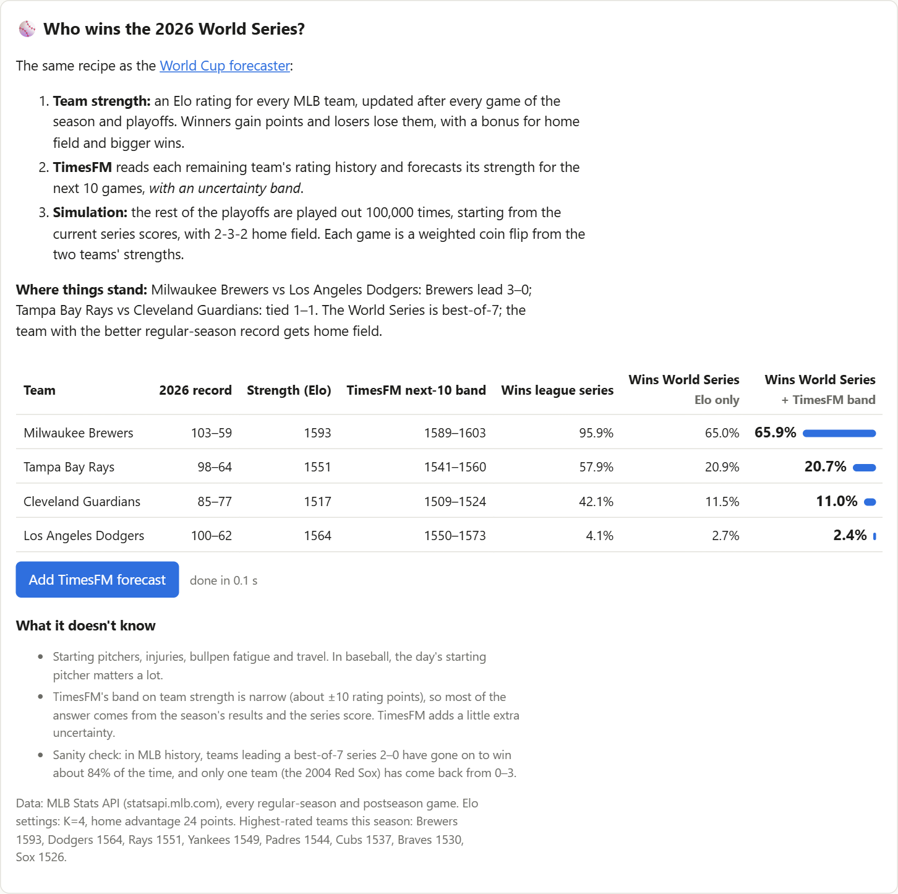
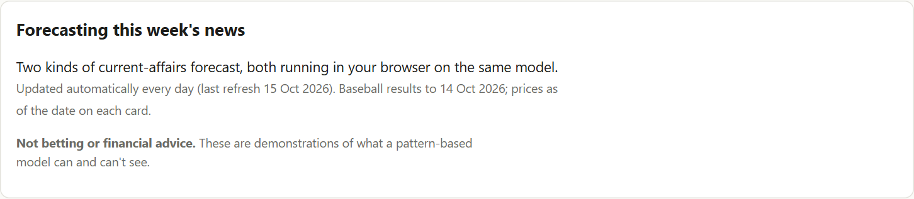
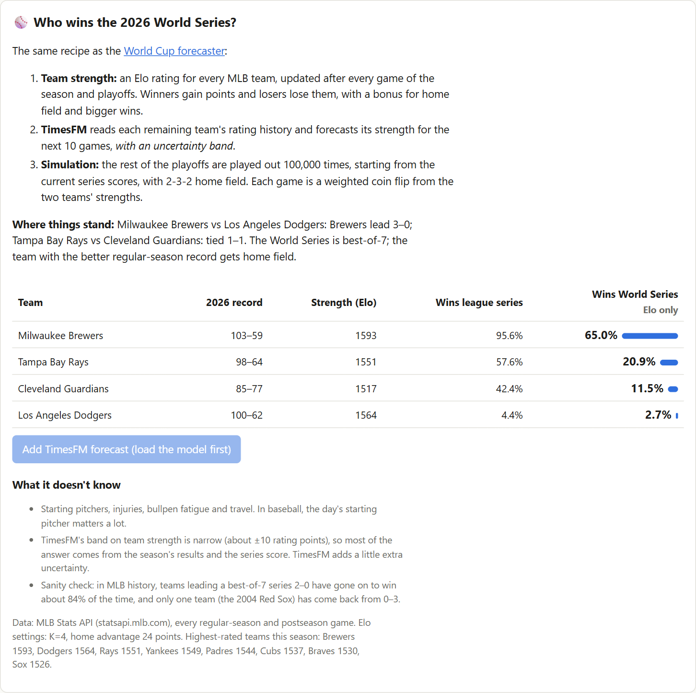
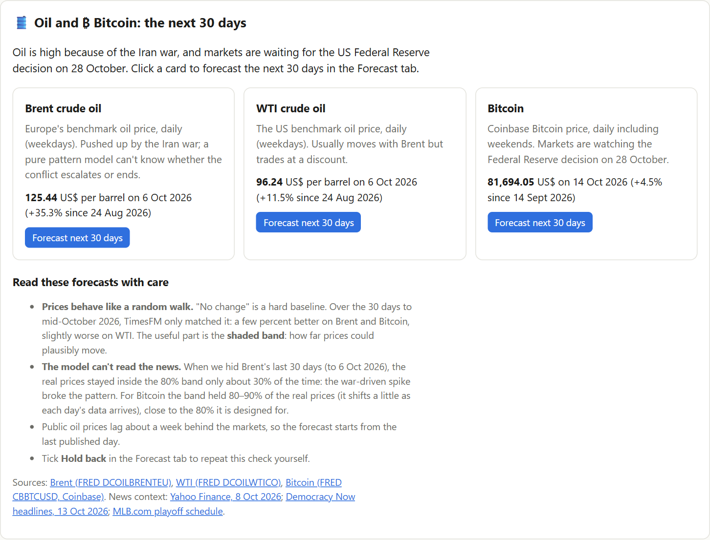
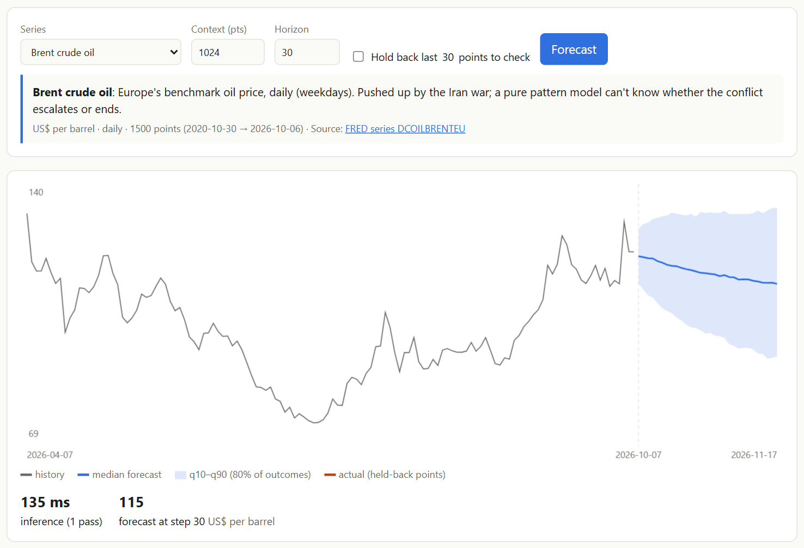
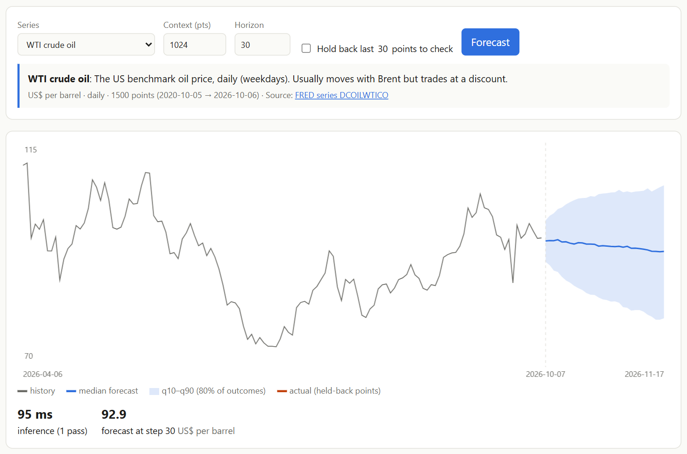
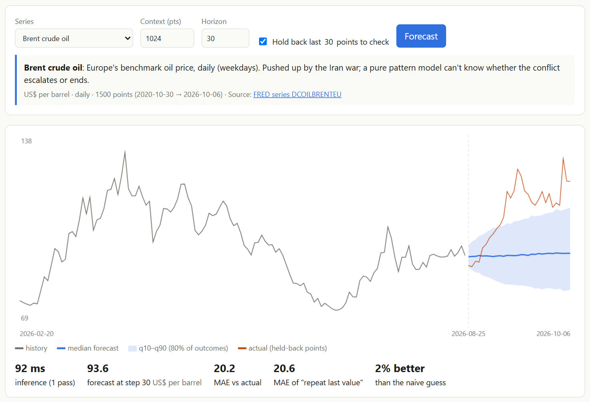
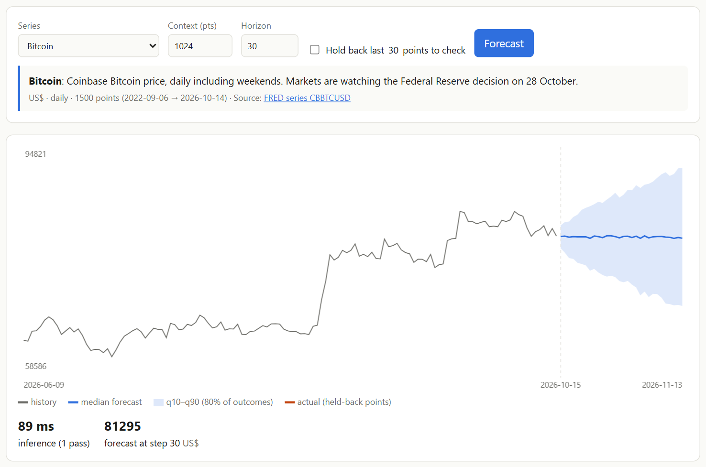
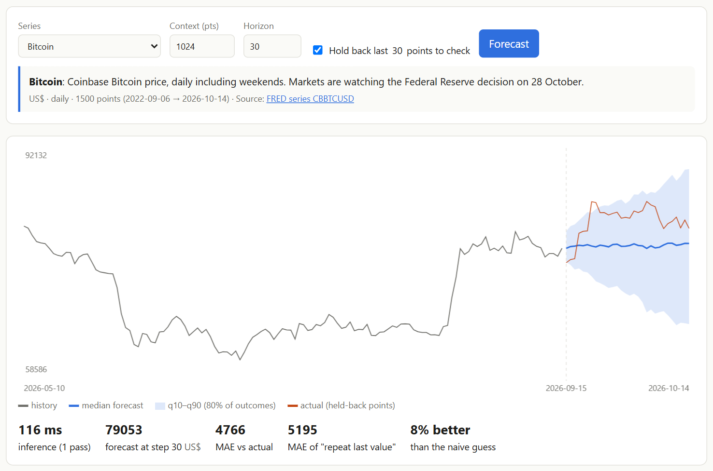

# I Asked Google's AI to Predict the World Series, Oil Prices and Bitcoin, Right in My Browser

*A free, open AI forecaster that runs on your own laptop, no server or sign-up needed, pointed at this week's biggest stories: the 2026 MLB playoffs, war-driven oil prices and Bitcoin before the Fed's next decision. Here's what it predicts, and the one thing it can never see coming.*

**Try it live:** https://vishalmysore.github.io/webTimesFM/#current
**Code:** https://github.com/vishalmysore/webTimesFM

> **Snapshot:** the numbers in this article are from **15 October 2026**. The live page refreshes itself every day, so it will show newer odds than you see here.

---

## Why forecast the news?

Every day the headlines are full of questions about the future. Who wins the World Series? Will oil keep climbing? Is Bitcoin about to break out? Pundits answer with opinions. A forecasting model answers with **numbers and a range**, and you can check later whether it was right.

I wanted to see how far a modern AI forecaster gets on real current affairs. It uses **only the data**, the same way it would forecast a shop's sales or a farm's harvest.

The model is **TimesFM 2.5** from Google Research, a 200-million-parameter "foundation model" for time series. It was trained on about 100 billion real-world data points, so it already knows what trends, seasons and cycles look like. You give it a list of numbers and it predicts what comes next, plus how uncertain it is.

In this project it runs **entirely in your web browser** on your own graphics card (WebGPU). No data goes to a server, because there isn't one.

---

## ⚾ World Series 2026 prediction: who wins?

### How the forecast works

A forecaster can't answer "who wins a tournament" directly, so the question is turned into numbers in three steps. It's the same recipe I used to [forecast the 2026 FIFA World Cup](https://github.com/vishalmysore/webForecast/blob/main/article_soccer.md):

1. **Team strength (Elo ratings).** Every MLB team gets a rating that moves after each of the ~2,480 games this season and postseason. Beat a strong team and you gain a lot; lose at home to a weak one and you drop. Bigger wins move the rating more.
2. **TimesFM forecasts each team's strength** for the next 10 games from its rating history, with an **uncertainty band**: is this team on the rise, or fading?
3. **Simulation.** The rest of the playoffs are played out **100,000 times** in the browser, starting from the real series scores, with proper 2-3-2 home field. Each game is a weighted coin flip based on the two teams' strengths. That takes **less than a second**.

### Where things stand

- **NLCS:** Milwaukee Brewers lead the Los Angeles Dodgers **3–0**
- **ALCS:** Tampa Bay Rays and Cleveland Guardians are tied **1–1**
- **World Series:** starts 23 October

### The odds

| Team | 2026 record | Strength (Elo) | Wins league series | **Wins World Series** |
|---|---|---|---|---|
| **Milwaukee Brewers** | 103–59 | 1593 (best in MLB) | 95.9% | **65.9%** |
| Tampa Bay Rays | 98–64 | 1551 | 57.9% | **20.7%** |
| Cleveland Guardians | 85–77 | 1517 | 42.1% | **11.0%** |
| Los Angeles Dodgers | 100–62 | 1564 | 4.1% | **2.4%** |

**The Brewers are clear favourites:** the best record in baseball, the highest rating and a 3–0 series lead. A team has come back from 0–3 in an MLB postseason series only once, the 2004 Red Sox, so the Dodgers' 4% chance is about right.

**The American League is a coin flip with a lean.** The Rays have the stronger season and home field, but the Guardians have already won a game on the road.

### What does the AI add?

The page shows the odds **with and without** TimesFM's band. Without it (ratings only) the Brewers are 65.0%; with TimesFM's uncertainty about each team's form they're 65.9%. The difference is small, and that's an honest finding. In a short playoff series, **the series score and the season's results dominate**. TimesFM's role is to add realistic uncertainty about whether a team is heating up or cooling down.

### What it can't see

- **Starting pitchers.** In baseball, who's on the mound tonight matters enormously, and the model doesn't know.
- **Injuries, bullpen fatigue and travel.**
- **Momentum in the human sense.** It only sees results, not the clubhouse.

---

## 🛢️ Oil price forecast: Brent and WTI after the Iran war spike

Oil is the story of the autumn. The **Iran war** has pushed Brent crude, Europe's benchmark, from about **$93 in late August to $125 a barrel** by 6 October, a **35% jump in six weeks**.

### What TimesFM predicts for the next 30 trading days (to mid-November)

| | Latest price | Forecast in 30 trading days (median) | 80% range |
|---|---|---|---|
| **Brent** | $125.44 (6 Oct) | **$115** | $89 – $139 |
| **WTI** | $96.24 (6 Oct) | **$93** | $76 – $109 |

The model expects Brent to **drift back down**: after big spikes, prices tend to fall back. But look at the width of that band, **$89 to $139**. That's the model's way of saying *"this could be peace or escalation, and I can't tell which."*

### The honest test: what happened when we hid the last 30 days?

The page can hide the most recent stretch of data, forecast it, and compare with what really happened:

This chart shows the problem. Hiding Brent's 30 trading days to 6 October, TimesFM forecast roughly flat prices around $94, with a band up to about $112. Then the war escalated and the real price (orange) **shot up to $125**, far outside the band. Only **30%** of the real prices landed inside the 80% band.

**A pattern model cannot read the news.** Nothing in the price history said a war was about to escalate.

---

## ₿ Bitcoin price prediction: November 2026

Bitcoin is trading around **$81,700** (14 October), well below its 2025 record and up about 4.5% in a month. Markets are waiting for the **US Federal Reserve decision on 28 October**.

| | Latest price | Forecast for ~13 Nov (median) | 80% range |
|---|---|---|---|
| **Bitcoin** | $81,694 | **$81,300** | $68,500 – $94,600 |

TimesFM's call is **flat, with a wide range**. It sees no clear trend to extend, and expects about a ±16% swing either way within a month.

Here the band is well calibrated. When the last 30 days were hidden, **90% of the real prices landed inside it**, and the forecast was 8% closer than simply assuming "no change":

---

## Scorecard: how good is AI at forecasting current affairs?

Backtest: the last 30 days were hidden, then the forecast was compared with reality.

| Series | AI average miss | "No change" miss | Real values inside the 80% band |
|---|---|---|---|
| Bitcoin | $4,766 | $5,195 | **90%** ✅ |
| Brent oil | $20.2 | $20.6 | **30%** ❌ (war spike) |
| WTI oil | $9.84 | $9.55 | 73% |

**Three lessons:**

1. **For prices, "no change" is very hard to beat.** Markets already price in what's known. The AI roughly ties with the naive guess. That's normal, and anyone claiming much better should be asked for proof.
2. **The range is the real product.** For Bitcoin the band was well calibrated, and it tells you how much risk you're carrying.
3. **News breaks patterns.** The Brent spike came from a war, not from anything in the chart. That's the boundary of every model that only sees numbers.

---

## Updated automatically every day

You don't have to take this article's snapshot as final. A **GitHub Action** runs every day at 12:30 UTC. It downloads the latest MLB results and the latest oil and Bitcoin prices, then updates the page. When the World Series starts, the simulation switches to the World Series score; when it ends, the page names the champion.

The whole thing still costs nothing to run:
- **The model** (261 MB) loads once from Hugging Face and is cached by your browser.
- **The data** is a small JSON file refreshed by the daily job.
- **The forecasting and simulation** happen on your machine.

---

## What would make it smarter? Reading the news

The Brent chart is the best argument for the next step: pair the number forecaster with a **language model that reads headlines**. A browser LLM such as WebLLM could turn "Iran war escalates" into a structured signal (direction: up, strength: large, duration: weeks) and draw a clearly labelled **what-if band** next to the plain forecast.

Two traps would need care. Language models trained on past news already *remember* what happened, so testing on old events is cheating. And news often moves prices within days, which leaves little head start. I wrote more about this idea in the main article: **[Forecast Anything in Your Browser](article.md)**.

---

## Related projects

- **[Forecast Anything in Your Browser](article.md):** the main webTimesFM article, covering COVID, world poverty, wheat and maize prices, CO₂, sunspots and a tutorial for using your own data.
- **[Forecasting the 2026 World Cup in Your Browser](https://github.com/vishalmysore/webForecast/blob/main/article_soccer.md):** the same strength-forecast-plus-simulation recipe applied to all 48 teams at the FIFA World Cup, using a 70M TimesFM model ([live demo](https://vishalmysore.github.io/webForecast/wc/)).

---

## Try it yourself

1. Open **https://vishalmysore.github.io/webTimesFM/#current**.
2. The World Series odds appear instantly.
3. Go to the **Forecast** tab and click **Load model** (a one-time 261 MB download).
4. Come back and click **Add TimesFM forecast**, or click **Forecast next 30 days** on the oil and Bitcoin cards.
5. Tick **Hold back** to test the model on the last 30 days yourself.

**Not betting or financial advice.** This is a demonstration of what an AI forecaster can and can't see. Use it to understand uncertainty, not to place bets.

---

*Data: [MLB Stats API](https://statsapi.mlb.com) (every 2026 regular-season and postseason game); oil and Bitcoin prices from FRED ([DCOILBRENTEU](https://fred.stlouisfed.org/series/DCOILBRENTEU), [DCOILWTICO](https://fred.stlouisfed.org/series/DCOILWTICO), [CBBTCUSD](https://fred.stlouisfed.org/series/CBBTCUSD)). News context: [MLB.com playoff schedule](https://www.mlb.com/news/2026-mlb-playoff-and-world-series-schedule), [Yahoo Finance, 8 Oct 2026](https://finance.yahoo.com/personal-finance/investing/article/bitcoin-and-ethereum-prices-today-thursday-october-8-2026-crypto-values-fall-as-oil-prices-soar-113341860.html), [Democracy Now headlines, 13 Oct 2026](https://www.democracynow.org/2026/10/13/headlines). Model: [TimesFM](https://github.com/google-research/timesfm) by Google Research (Apache-2.0); this browser version is an unofficial community conversion and isn't endorsed by Google.*
