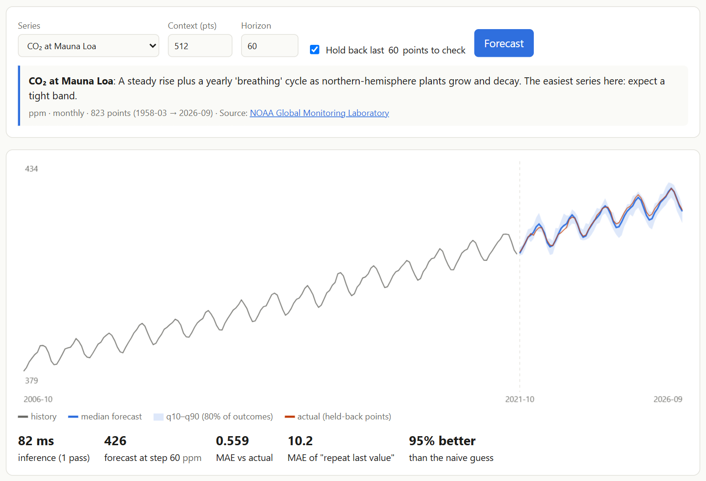
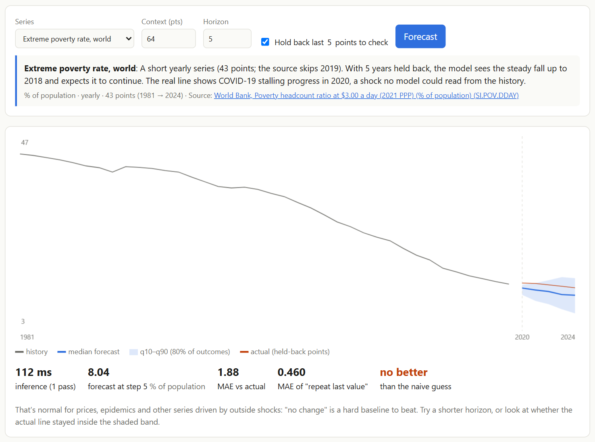
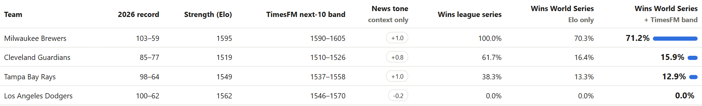

# TimesFM vs Chronos vs Moirai vs TimeGPT: Time-Series Forecasting Models Compared (2026)

*A plain-English guide to the forecasting models people actually use in 2026: Google's TimesFM, Amazon's Chronos, Salesforce's Moirai, Nixtla's TimeGPT and the newer challengers, plus the classics they're replacing. What each one is, how big it is, what licence it uses, and which to pick.*

**Snapshot date:** 18 October 2026. Model sizes and licences are taken from each model's official Hugging Face page on that date. This field moves fast, so check the links before you rely on a detail.

---

## Contents

1. [The short answer](#the-short-answer)
2. [Three generations of forecasting models](#three-generations-of-forecasting-models)
3. [The big comparison table](#the-big-comparison-table)
4. [The models, one by one](#the-models-one-by-one)
5. [Which is most accurate?](#which-is-most-accurate)
6. [Licences: the detail that decides for most teams](#licences-the-detail-that-decides-for-most-teams)
7. [Which model should you use?](#which-model-should-you-use)
8. [TimesFM 2.5 vs Chronos-2, side by side in the browser](#timesfm-25-vs-chronos-2-side-by-side-in-the-browser)
9. [What we learned running TimesFM ourselves](#what-we-learned-running-timesfm-ourselves)
10. [FAQ](#faq)
11. [Sources](#sources)
12. [Disclaimer](#disclaimer)

---

## The short answer

- **Best all-rounder with an open licence:** **Amazon Chronos-2** (120M, Apache-2.0). It handles single series, many related series and extra inputs (covariates) in one model.
- **Best for long histories and simple deployment:** **Google TimesFM 2.5** (200M, Apache-2.0). It reads up to 16,384 past points, and it's the first model behind [webTimesFM](https://vishalmysore.github.io/webTimesFM/).
- **Both run in a web browser.** webTimesFM runs TimesFM 2.5 and Chronos-2 side by side, so you can [test them on the same data](#timesfm-25-vs-chronos-2-side-by-side-in-the-browser). On our 10 real series neither won outright, and "no change" beat both on half of them.
- **Smallest and fastest:** **IBM Tiny Time Mixers** (under 1M parameters, Apache-2.0). It runs comfortably on a CPU.
- **Strong but restricted:** **TimesFM 3.0**, **Moirai** and **TiRex** all perform well, but their weights are non-commercial or carry custom licence terms.
- **No machine learning team at all?** **Nixtla TimeGPT** is a paid API: send numbers, get forecasts back.
- **Still worth trying first:** **ARIMA, ETS or Prophet** on one important, well-behaved series. Always compare against a simple baseline.

---

## Three generations of forecasting models

| Generation | Examples | How it works | Training needed? |
|---|---|---|---|
| **1. Classical statistics** (1970s–2010s) | ARIMA, ETS (exponential smoothing), Theta, Prophet | Fit a small formula (trend + season + noise) to **one** series | Yes, per series, but in seconds |
| **2. Deep learning, trained per dataset** (2017–2023) | DeepAR, N-BEATS, N-HiTS, Temporal Fusion Transformer, PatchTST | A neural network trained on **your** collection of related series | Yes, needs your data and GPU time |
| **3. Foundation models, zero-shot** (2023–now) | TimesFM, Chronos, Moirai, TimeGPT, TiRex, Toto, Sundial, TTM | One large model pre-trained on **billions of points** from many domains, then used as-is | **No.** Optional fine-tuning only |

Generation 3 is the big shift. Like GPT for text, a **time-series foundation model** has already seen so many patterns that it can forecast data it has never met, with zero training. That's called **zero-shot forecasting**.

---

## The big comparison table

| Model | Maker | Released (latest) | Size | Inside | Multivariate and covariates | Weights licence |
|---|---|---|---|---|---|---|
| **TimesFM 2.5** | Google Research | Sept 2025 | 200M (+30M quantile head) | Decoder-only transformer on patches of 32 | Single series; covariates via add-on regression (XReg) | **Apache-2.0** |
| **TimesFM 3.0** | Google Research | Aug 2026 | 331M | Decoder-only transformer | **Yes, native** | Non-commercial (commercial use via Google Cloud BigQuery ML) |
| **Chronos-2** | Amazon | Oct 2025 | 120M | Encoder-only (T5-style) with group attention | **Yes, native** | **Apache-2.0** |
| Chronos-Bolt | Amazon | Nov 2024 | up to 205M | Patch-based T5 encoder-decoder; much faster than original Chronos | Single series | Apache-2.0 |
| Chronos (original) | Amazon | Feb 2024 | up to 709M | T5 language model on numbers scaled and binned into "tokens" | Single series | Apache-2.0 |
| **Moirai 2.0** | Salesforce | 2025 | 11M (small) | Decoder-only transformer, quantile output | Single series | **CC-BY-NC-4.0** (non-commercial) |
| Moirai 1.x / Moirai-MoE | Salesforce | 2024 | up to 311M / MoE | Masked encoder, "any-variate" attention; MoE = mixture of experts | **Yes** | CC-BY-NC-4.0 |
| **TimeGPT-2** | Nixtla | Oct 2025 (2.1 later) | Not disclosed | Proprietary | Yes (exogenous variables) | **Closed, paid API**; self-hosted for enterprise |
| **TiRex** | NX-AI | May 2025 | 35M | **xLSTM** (a modern recurrent network), not a transformer | Single series | NX-AI community licence (custom) |
| **Toto** | Datadog | Apr 2025 | 151M | Decoder-only transformer, time-wise and variate-wise attention | **Yes**, built for observability metrics | **Apache-2.0** |
| **Sundial** | Tsinghua (THUML) | May 2025 | 128M | Decoder-only transformer + **flow matching** (generates many possible futures) | Single series | **Apache-2.0** |
| Timer | Tsinghua (THUML) | Nov 2024 | 84M | Decoder-only transformer, GPT-style next-patch | Single series | Apache-2.0 |
| **Tiny Time Mixers (TTM r2)** | IBM | Oct 2024 | **0.8M** (variants to a few M) | MLP-Mixer, not a transformer | Yes, with fine-tuning | **Apache-2.0** |
| Lag-Llama | ServiceNow, Mila and others | Feb 2024 | 2.4M | Llama-style decoder using lagged values as features | Single series | Apache-2.0 |
| MOMENT | Carnegie Mellon (Auton Lab) | May 2024 | ~350M (large) | T5 encoder; also classification, anomaly detection, imputation | Single series | MIT |

**How popular are they?** Hugging Face downloads in the past month: **Chronos-2 about 16.6 million**, TimesFM 2.5 about 1.6 million, TimesFM 3.0 about 1.0 million, Chronos-Bolt-Base about 0.8 million, Moirai 2.0 small about 0.26 million.

---

## The models, one by one

### Google TimesFM (2.5 and 3.0)
**"GPT for numbers."** A decoder-only transformer that reads **patches of 32 values** and predicts the next **128 values** at once, with 10 quantiles for every step. It was pre-trained on about 100 billion real time points (Google Trends, Wikipedia page views, synthetic and public data).
- **2.5:** 200M parameters plus an optional 30M quantile head. It reads up to **16k points** of history and is **Apache-2.0**. Covariates are supported through Google's XReg add-on.
- **3.0:** adds **native multivariate forecasting and covariates**. Google reports top ranks on fev-bench, the TIME benchmark and GIFT-Eval. Its downloadable weights are **non-commercial**; commercial use goes through BigQuery ML.
- **Read more:** [What Is TimesFM?](what-is-timesfm.md)

### Amazon Chronos (original, Bolt, Chronos-2)
- **Original Chronos (2024):** a language model applied to numbers. Values are scaled and **binned into tokens**, then a T5 model predicts the next token.
- **Chronos-Bolt:** switched to patches for big speed gains.
- **Chronos-2 (Oct 2025):** the current flagship. It's a 120M **encoder-only** model with **group attention**, which lets it look across related series and covariates at the same time. One model handles univariate, multivariate and covariate-informed forecasting, with context up to 8,192 and horizons up to 1,024. It's Apache-2.0 and by far the most downloaded.

### Salesforce Moirai (1.x, MoE, 2.0)
- **Moirai 1:** designed for **any number of variables**, with "any-variate" attention and a mixture-distribution output.
- **Moirai-MoE:** added a mixture of experts.
- **Moirai 2.0 (2025):** went the other way, toward **smaller and simpler**. It's a decoder-only model with quantile outputs, and the small version has just 11M parameters. Salesforce reports it's about 30× smaller and 2× faster than Moirai 1.0-Large while staying competitive.
- **Licence:** all Moirai weights are **CC-BY-NC-4.0**, so research and personal use only.

### Nixtla TimeGPT (TimeGPT-1, TimeGPT-2)
One of the first **commercial** time-series foundation models (2023). It's offered as an **API**: you send data and get forecasts back, with support for exogenous variables, anomaly detection and fine-tuning. **TimeGPT-2** (Mini, standard and Pro) launched as a private preview in October 2025, with TimeGPT-2.1 following. Weights aren't public; enterprises can self-host. Free research access exists.

### NX-AI TiRex
The odd one out: it's built on **xLSTM**, a modernised recurrent network from the inventors of the LSTM, not a transformer. At only **35M parameters** it's consistently near the top of public leaderboards, a reminder that bigger isn't always better. It uses a custom NX-AI community licence; read it before commercial use.

### Datadog Toto
A 151M model built for **observability**: server metrics, latency and error rates. It was trained on over **2 trillion** data points, which Datadog says is the largest pre-training set of any open-weights time-series model. It's natively multivariate and Apache-2.0, and comes with its own observability benchmark, BOOM.

### Tsinghua Sundial and Timer
- **Timer:** a GPT-style next-patch predictor.
- **Sundial (128M, trained on 1 trillion points):** adds **flow matching**, a generative technique that samples **many plausible futures** instead of a single line plus quantiles.
- **Licence:** both Apache-2.0.

### IBM Tiny Time Mixers (TTM)
Proof that you don't need a giant model. TTM uses a lightweight **MLP-Mixer** design with **under 1 million parameters** in its default version. It runs fast on a CPU and is easy to fine-tune on your own data. Apache-2.0.

### Lag-Llama and MOMENT
- **Lag-Llama (2024):** an early open foundation model with a Llama-style decoder fed with **lagged values**. Tiny (2.4M) and historically important.
- **MOMENT (CMU):** a family of T5-encoder models that do **more than forecasting**: classification, anomaly detection and filling in missing values.

### The classics: ARIMA, ETS, Prophet
Still useful. They're tiny, fast and explainable, and on one clean, well-understood series they can match or beat a foundation model. They need fitting for every series and some expertise, and they struggle when you have thousands of series or very little history.

---

## Which is most accurate?

There's no single winner. **The answer depends on the benchmark and the metric.**

- **Chronos-2's paper (Oct 2025)**, on the GIFT-Eval benchmark: average win rate **79.8%** for Chronos-2, 70.4% for TiRex, 70.0% for TimesFM 2.5, 60.9% for Toto, 56.0% for Moirai 2.0.
- **Google (Aug 2026)** reports **TimesFM 3.0** at #1 on fev-bench and the TIME benchmark, and #1 among foundation models on GIFT-Eval.
- **An independent "living" benchmark (LiveHouse-TS)** shows how close the top is:
  - **Overall:** Chronos-2 0.671, TiRex 0.668, TimesFM 2.5 0.609.
  - **Point accuracy (MSE win rate):** TimesFM 2.5 is **first** at 0.680, ahead of TiRex 0.673 and Chronos-2 0.668.
  - **Probabilistic accuracy (CRPS):** Chronos-2 0.634, TiRex 0.615, Moirai 2.0 0.546.

**Two cautions:**
1. **Training-data overlap.** Some models were pre-trained on parts of the same public datasets that benchmarks use. Benchmark authors flag this, and it can flatter scores.
2. **Your data isn't a benchmark.** Finance, energy or sales data can rank models differently from a broad public benchmark, and researchers are actively testing these models against classic econometric methods in specific fields.

**Practical rule:** shortlist two or three models, test them on **your own** data with a hold-out period, and always include a naive "no change" or seasonal-naive baseline.

---

## Licences: the detail that decides for most teams

| You can use it commercially, free | Research and non-commercial only | Custom terms or paid |
|---|---|---|
| TimesFM 1.0–2.5, Chronos (all), Toto, Sundial, Timer, TTM, Lag-Llama, MOMENT (MIT) | TimesFM 3.0 weights, Moirai (all versions) | TiRex (NX-AI community licence), TimeGPT (paid API) |

That's why many production teams in 2026 run **Chronos-2** or **TimesFM 2.5**: strong accuracy *and* Apache-2.0.

---

## Which model should you use?

| Your situation | Good first choice | Why |
|---|---|---|
| One series, want a quick, explainable forecast | **ETS / ARIMA** + **TimesFM 2.5** to compare | Classic baseline plus a zero-shot check |
| Many series, open licence, best all-round accuracy | **Chronos-2** | Strong benchmarks, Apache-2.0, native multivariate |
| Very long history (years of daily or hourly data) | **TimesFM 2.5** | Reads up to 16k points |
| Related series and known future inputs (prices, holidays, weather) | **Chronos-2**, or TimesFM 2.5 + XReg | Native covariates |
| Server and app metrics (observability) | **Toto** | Built and benchmarked for it |
| Laptop, edge device or CPU only | **Tiny Time Mixers** or **TiRex** | Under 1M and 35M parameters |
| In a web browser, no server | **TimesFM 2.5** or **Chronos-2** (ONNX) | Both run in [webTimesFM](https://vishalmysore.github.io/webTimesFM/), with a "Compare both" mode |
| No ML team, want an API | **TimeGPT** | Managed service |
| Want many possible futures, not just quantiles | **Sundial** | Generative flow-matching |
| Research only, want the newest | **TimesFM 3.0**, **Moirai 2.0** | Top results, non-commercial weights |

---

## TimesFM 2.5 vs Chronos-2, side by side in the browser

Benchmarks rank these two models close together. We wanted to see how they do on everyday data, so [webTimesFM](https://vishalmysore.github.io/webTimesFM/) now runs **both** in the browser, and its **Compare both** mode draws the two forecasts on one chart.

**The setup.** Both models run as 8-bit ONNX files through ONNX Runtime Web: TimesFM 2.5 (261 MB) and Chronos-2 (153 MB, our [conversion](https://huggingface.co/VishalMysore/chronos-2-onnx-web)). Before trusting the comparison, we checked the browser version of Chronos-2 against Amazon's own PyTorch code. At full precision it matched to within 0.0001 of a standard deviation, and the 8-bit median forecast stayed within 0.04 of a typical step of full precision. So the differences below come from the models, not from the conversion.

**The test.** For each of 10 real series, we hid the most recent points, asked both models to forecast them, and measured the average miss (MAE, lower is better). The baseline is "no change": repeat the last known value.

| Series (points hidden) | "No change" | TimesFM 2.5 | Chronos-2 | Closest |
|---|---|---|---|---|
| CO₂ at Mauna Loa, ppm (60 months) | 10.24 | **0.56** | 0.97 | TimesFM |
| Sunspots, monthly mean (120 months) | 50.1 | **42.5** | 44.1 | TimesFM |
| Bitcoin, US$ (30 days) | 7,153 | **6,949** | 7,272 | TimesFM |
| Wheat price, US$/t (24 months) | 15.07 | 21.84 | **13.14** | Chronos-2 |
| Maize price, US$/t (24 months) | 25.01 | 29.46 | **16.30** | Chronos-2 |
| World extreme poverty, % (5 years) | **0.46** | 1.88 | 0.95 | No change |
| US unemployment, % (24 months) | **0.100** | 0.126 | 0.280 | No change |
| COVID-19 cases, USA, 7-day avg (60 days) | **28,940** | 35,320 | 42,390 | No change |
| Brent oil, US$/barrel (30 days) | **22.0** | 22.2 | 24.7 | No change |
| WTI oil, US$/barrel (30 days) | **6.79** | 7.91 | 8.46 | No change |

*Measured 18 October 2026. Oil and Bitcoin data run to 14 and 16 October 2026 and are refreshed daily, so their numbers change.*

**What it shows**

- **No overall winner.** Head to head, TimesFM was closer on 7 series and Chronos-2 on 3. But TimesFM beat "no change" on 3 series and Chronos-2 on 4.
- **TimesFM was better on smooth, regular patterns.** On CO₂ (steady rise plus a yearly cycle) and sunspots (an 11-year cycle) it was the clear winner.
- **Chronos-2 was better on the crop prices.** On wheat and maize it beat both TimesFM and "no change" by a wide margin.
- **"No change" won half the tests.** Oil, unemployment, COVID and poverty were all driven by events that no history could predict. Neither model can see those coming.
- **Chronos-2 is lighter.** It's a smaller download (153 MB vs 261 MB) and was a little faster: 55–85 ms per forecast on WebGPU against 90–135 ms for TimesFM, and about 1 s against 2 s on a CPU.

Ten series with one hold-out period each is a small test, not a benchmark. Treat it as an example of how to compare models on your own data, not as a ranking. You can rerun every row in the browser: pick a series, choose **Compare both**, and keep **Hold back** ticked.

---

## What we learned running TimesFM ourselves

We run **TimesFM 2.5 entirely in a web browser** (ONNX Runtime Web on WebGPU, 8-bit weights, 261 MB). Three lessons apply to every model on this page.

**1. Foundation models shine on patterns.** CO₂ at Mauna Loa, a steady rise plus a yearly cycle, was forecast five years ahead, **95% better than "no change"**:

**2. They can't see shocks.** Nothing in the history of world poverty data could reveal that COVID-19 would stall progress in 2020:

**3. They're best as one stage of a bigger system.** For the World Series, TimesFM forecasts each team's strength, then a simulation plays out 100,000 playoffs. For the [2026 World Cup](https://github.com/vishalmysore/webForecast/blob/main/article_soccer.md), a 70M TimesFM did the same for all 48 teams.

Whichever model you choose, **test it against "no change"**. For prices, it's very hard to beat.

---

## FAQ

### What is the best time-series foundation model in 2026?
There's no single best. Chronos-2, TimesFM (2.5 and 3.0) and TiRex trade the top spots depending on the benchmark and metric. For an open, commercial-friendly licence, Chronos-2 and TimesFM 2.5 are the usual picks.

### TimesFM vs Chronos: which is better?
They're close. Chronos-2 is smaller (120M vs 200M), natively handles multivariate data and covariates, and ranks higher on some probabilistic benchmarks. TimesFM 2.5 reads longer histories (16k vs 8k points) and ranks first on some point-accuracy measures. On our [10 real series](#timesfm-25-vs-chronos-2-side-by-side-in-the-browser), TimesFM was closer on 7 and Chronos-2 on 3, but each beat "no change" on only 3 or 4. Test both on your data.

### Is TimeGPT open source?
No. TimeGPT is a commercial API from Nixtla. Open-weights alternatives include TimesFM 2.5, Chronos-2, Toto and Sundial (all Apache-2.0).

### Can I use Moirai commercially?
Not the published weights. Salesforce releases Moirai under CC-BY-NC-4.0, which is non-commercial.

### Do these models replace ARIMA and Prophet?
Not entirely. They remove most of the setup work and often win on large or messy collections of series. On a single clean series, a well-tuned classic model can still match them. Always compare.

### Do I need a GPU?
Not for forecasting. Small models like TTM and TiRex run on a CPU, and TimesFM 2.5 and Chronos-2 even run in a web browser. GPUs help with large batches or fine-tuning.

### Can these models use news or other text?
No. They read numbers only. To use news, convert it into numbers first, for example a daily sentiment score, and feed it in as a covariate or use it as a warning signal. [webTimesFM](https://vishalmysore.github.io/webTimesFM/#current) shows one way to do this.

---

## Sources

- Model cards on Hugging Face (sizes and licences, checked 18 Oct 2026): [TimesFM 2.5](https://huggingface.co/google/timesfm-2.5-200m-pytorch), [TimesFM 3.0](https://huggingface.co/google/timesfm-3.0-pytorch), [Chronos-2](https://huggingface.co/amazon/chronos-2), [Chronos-Bolt](https://huggingface.co/amazon/chronos-bolt-base), [Moirai 2.0](https://huggingface.co/Salesforce/moirai-2.0-R-small), [TiRex](https://huggingface.co/NX-AI/TiRex), [Toto](https://huggingface.co/Datadog/Toto-Open-Base-1.0), [Sundial](https://huggingface.co/thuml/sundial-base-128m), [TTM](https://huggingface.co/ibm-granite/granite-timeseries-ttm-r2), [Lag-Llama](https://huggingface.co/time-series-foundation-models/Lag-Llama), [MOMENT](https://huggingface.co/AutonLab/MOMENT-1-large)
- Google TimesFM repository and release notes: [github.com/google-research/timesfm](https://github.com/google-research/timesfm)
- [Chronos-2: From Univariate to Universal Forecasting](https://arxiv.org/pdf/2510.15821) (paper) and [Amazon Science blog](https://www.amazon.science/blog/introducing-chronos-2-from-univariate-to-universal-forecasting)
- [Moirai 2.0: When Less Is More for Time Series Forecasting](https://arxiv.org/pdf/2511.11698) and the [Salesforce blog](https://www.salesforce.com/blog/moirai-2-0/)
- [Nixtla: TimeGPT-2 announcement](https://www.nixtla.io/blog/timegpt-2-announcement) and [TimeGPT-2 family docs](https://www.nixtla.io/docs/forecasting/timegpt_2_family)
- [TiRex paper](https://arxiv.org/abs/2505.23719), [Sundial paper](https://arxiv.org/pdf/2502.00816), [MOMENT paper](https://arxiv.org/pdf/2402.03885), [Lag-Llama paper](https://arxiv.org/abs/2310.08278)
- [LiveHouse-TS: An Open-world Living Benchmark for Time Series Foundation Models](https://arxiv.org/pdf/2608.17299)

---

## More from this project

- **[What Is TimesFM?](what-is-timesfm.md):** Google's model explained, and how we run it in the browser.
- **[Forecast Anything in Your Browser](article.md):** COVID, poverty, farming, climate and a tutorial.
- **[I Asked Google's AI to Predict the World Series, Oil Prices and Bitcoin](current-affairs.md)**
- **[Forecasting the 2026 World Cup in Your Browser](https://github.com/vishalmysore/webForecast/blob/main/article_soccer.md)**

---

## Disclaimer

**Please read before using the forecasts on this site or in this article.**

### Not affiliated with Google or Amazon
- **TimesFM** is created by **Google Research**: [paper](https://arxiv.org/abs/2310.10688), [code](https://github.com/google-research/timesfm), [TimesFM 2.5 weights](https://huggingface.co/google/timesfm-2.5-200m-pytorch). "Google" and "TimesFM" are names and trademarks of Google LLC.
- **Chronos-2** is created by **Amazon**: [paper](https://arxiv.org/abs/2510.15821), [code](https://github.com/amazon-science/chronos-forecasting), [weights](https://huggingface.co/amazon/chronos-2).
- **webTimesFM** is an **independent, unofficial community project**. It is not made, sponsored, reviewed or endorsed by Google or Amazon, and nothing here speaks for them.

### About the browser model
- The model running here is a **conversion** of Google's TimesFM 2.5 weights to ONNX, compressed to 8-bit and 4-bit. The weights' values come only from Google's release; they were not retrained or fine-tuned.
- Compression and the browser re-implementation of the pre- and post-processing mean its forecasts **can differ slightly** from Google's official code. The 4-bit model differs more, especially on short series. Use the **Run self-test vs PyTorch** button to check on your own machine.
- TimesFM 2.5 code and weights are licensed under **Apache-2.0** and are provided **"as is", without warranties or conditions of any kind**. The changes made for this conversion are listed on the [model card](https://huggingface.co/VishalMysore/timesfm-2.5-200m-onnx-web). TimesFM 3.0, which has a separate non-commercial licence, is **not** used or included.
- **Chronos-2** runs the same way: an ONNX conversion of Amazon's Apache-2.0 weights, 8-bit or 4-bit, not retrained. Its changes and accuracy checks are on its own [model card](https://huggingface.co/VishalMysore/chronos-2-onnx-web).

### Not financial, investment or betting advice
- The oil, Bitcoin and other price forecasts are **educational demonstrations**, not recommendations to buy, sell or hold anything. Prices behave much like a random walk, and in our own tests the model roughly ties a simple "no change" guess.
- The World Series odds are an **illustration of a forecasting method**, not betting tips. They ignore starting pitchers, injuries and much else that matters.
- Forecasts can be, and often are, **wrong**. Past accuracy doesn't guarantee future results. Don't make financial, betting, business, medical or policy decisions based on this site. Consult a qualified professional instead.

### About the data and the news signal
- Data comes from **third-party public sources**: MLB Stats API, FRED (Federal Reserve Bank of St. Louis), IMF, World Bank, US Bureau of Labor Statistics, NOAA, SILSO / Royal Observatory of Belgium, Johns Hopkins CSSE and Google News. Each is subject to its own terms and is used here for **non-commercial, educational purposes**.
- Data can be **delayed, revised or incomplete**. For example, official oil prices lag the market by about a week. It's refreshed automatically once a day, with no manual checking, and accuracy isn't guaranteed.
- News headlines belong to their **publishers** and are linked, not copied in full. The news tone is scored **automatically** by a simple sentiment model (VADER). It can misread sarcasm, context or mixed stories, and it isn't an editorial judgement about any team, company or event.
- Team and league names are trademarks of their respective owners. This project isn't affiliated with or endorsed by Major League Baseball or any team.

### Privacy
- Forecasts run **entirely in your browser**. Numbers you paste or upload aren't sent to any server by this site.
- Your browser does download files from third parties: the model from **Hugging Face**, and ONNX Runtime from the **jsDelivr** CDN. Those services may log the request, as any website does.

### Use at your own risk
This is a free, open-source demonstration for learning and research. It's provided **as is**, with no warranty of any kind. The author isn't liable for any loss or damage arising from its use. Always verify important numbers with the original sources.
