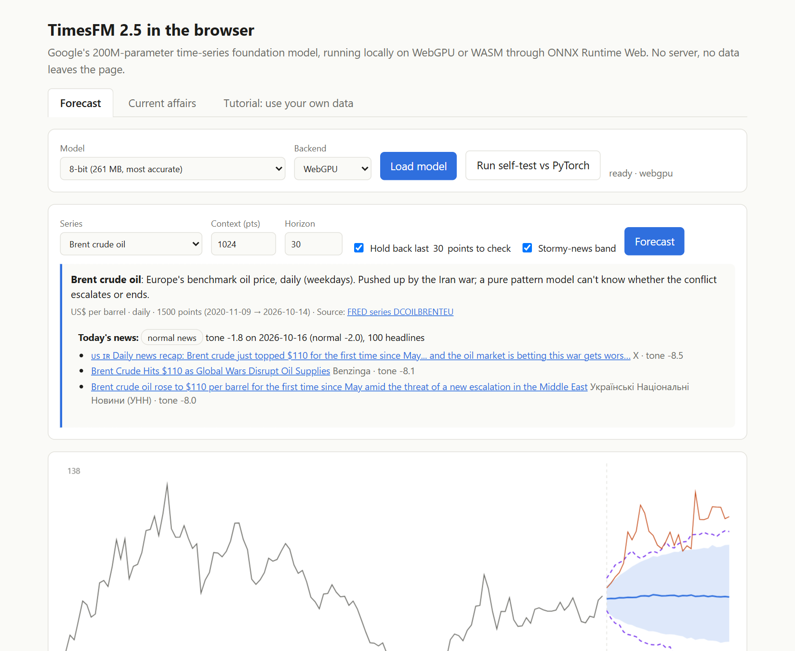
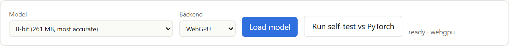
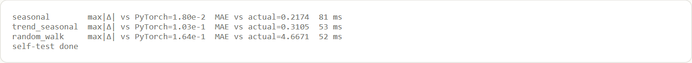
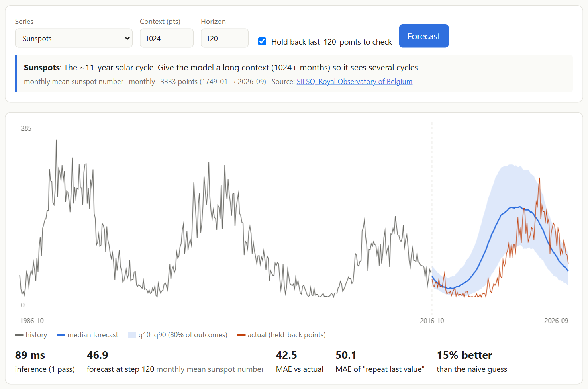
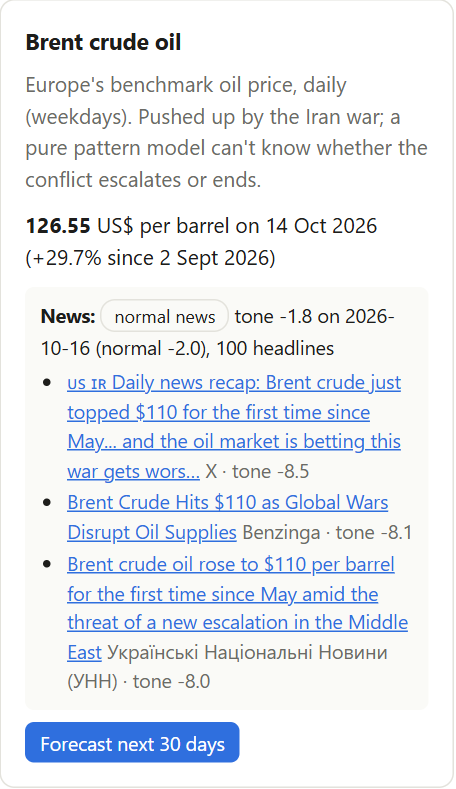
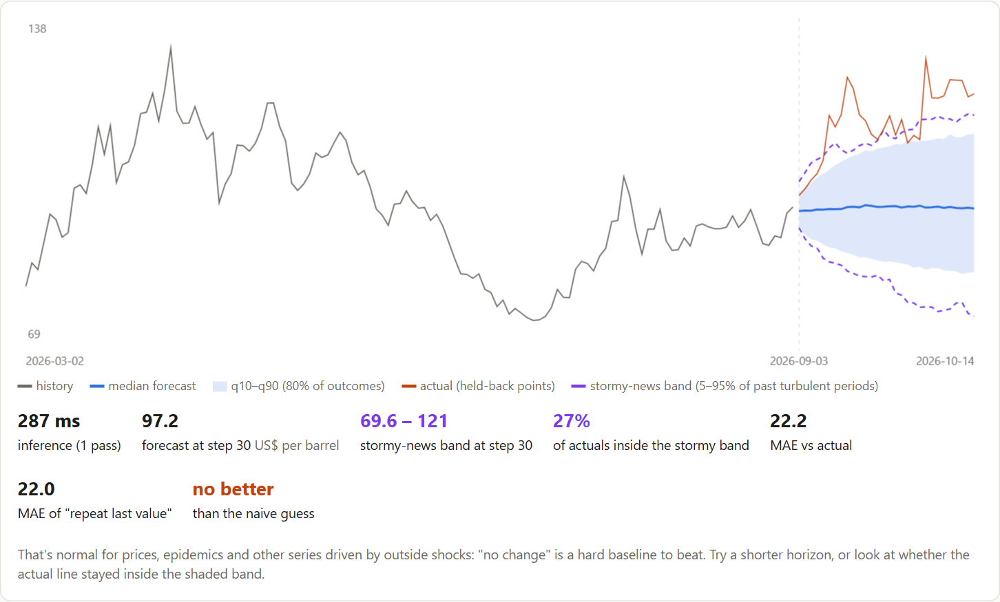
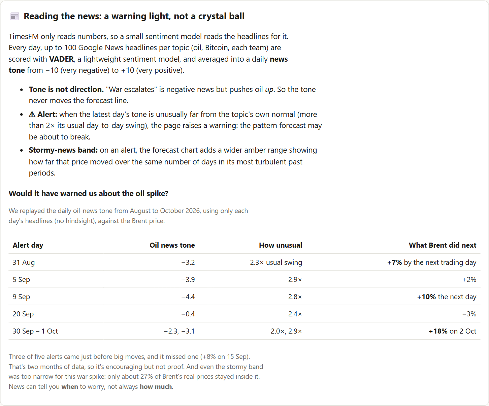
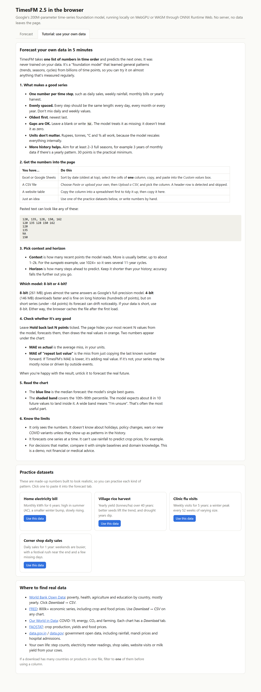

# What Is TimesFM? Google's Time-Series Foundation Model Explained, and How to Run It in Your Browser

*A plain-English guide to Google's TimesFM: what it is, how it's built, why it's called a "foundation model", and what you can do with it, from forecasting CO₂ and oil prices to World Series odds, running free in a web browser.*

**Try it now:** https://vishalmysore.github.io/webTimesFM/
**Code:** https://github.com/vishalmysore/webTimesFM
**Model files (ONNX):** https://huggingface.co/VishalMysore/timesfm-2.5-200m-onnx-web



---

## Contents

1. [What is TimesFM?](#what-is-timesfm)
2. [What is a time-series foundation model?](#what-is-a-time-series-foundation-model)
3. [How TimesFM is built](#how-timesfm-is-built)
4. [TimesFM versions: 1.0, 2.0, 2.5 and 3.0](#timesfm-versions-10-20-25-and-30)
5. [What we built: TimesFM in your web browser](#what-we-built-timesfm-in-your-web-browser)
6. [What TimesFM does well, and where it fails](#what-timesfm-does-well-and-where-it-fails)
7. [Forecasting current affairs: World Series, oil and Bitcoin](#forecasting-current-affairs-world-series-oil-and-bitcoin)
8. [Adding the news: sentiment as a warning light](#adding-the-news-sentiment-as-a-warning-light)
9. [How to use TimesFM in your own web page](#how-to-use-timesfm-in-your-own-web-page)
10. [FAQ](#faq)
11. [Disclaimer](#disclaimer)

---

## What is TimesFM?

**TimesFM** (short for **Time Series Foundation Model**) is an open AI model from **Google Research** that forecasts numbers over time. Give it any list of numbers in time order, such as daily sales, monthly rainfall, hourly electricity use or a stock price, and it predicts what comes next, together with a range of likely outcomes.

What makes it special is that **you don't have to train it**. TimesFM has already learned what trends, seasons and cycles look like from about **100 billion real-world data points**. It can forecast a series it has never seen before, straight away. This is called **zero-shot forecasting**.

It was introduced in the research paper *"A decoder-only foundation model for time-series forecasting"* by Abhimanyu Das, Weihao Kong, Rajat Sen and Yichen Zhou (ICML 2024). The code and the model weights up to version 2.5 are open source under the **Apache-2.0** licence.

**In one sentence:** TimesFM is like ChatGPT, but instead of reading and writing words, it reads and writes numbers.

---

## What is a time-series foundation model?

A **foundation model** is a large AI model that is:

1. **Pre-trained once** on a huge and varied dataset,
2. **General-purpose**, not built for one task,
3. **Usable straight away** on new problems (zero-shot), and
4. **Adaptable**: it can be fine-tuned further if you want.

GPT, Gemini and Claude are foundation models for **text**. TimesFM is a foundation model for **time series**, along with others such as Amazon's Chronos, Salesforce's Moirai, Lag-Llama and Nixtla's TimeGPT.

### TimesFM vs traditional forecasting (ARIMA, Prophet)

| | Traditional model (ARIMA, Prophet, ETS) | Foundation model (TimesFM) |
|---|---|---|
| Training | Fitted separately for **each** series | Trained **once**, used for everything |
| Setup | Needs a data scientist to choose and tune | Paste your numbers, get a forecast |
| Knowledge | Knows only that one series | Has "seen" millions of patterns |
| Uncertainty | Often a single line, or a fitted interval | Built-in quantiles (10%…90%) for every step |
| Best when | You have one important series and time to tune | You have many series, little time, or little history |

---

## How TimesFM is built

### The core idea: GPT's architecture, applied to numbers

TimesFM is a **decoder-only transformer**, the same family of neural network as GPT, Gemini and Llama, from Google's 2017 paper *"Attention Is All You Need"*. Google's key change is what counts as a "token":

| | Language model (GPT-style) | TimesFM |
|---|---|---|
| Input token | a word or piece of a word | a **patch of 32 consecutive numbers** |
| Task | predict the next word | predict the **next 128 numbers** |
| Trained on | text from the internet | **~100 billion real time points** |
| Output | probabilities over a vocabulary | actual values plus **quantiles** (a range) |

Feeding the model **patches** instead of single values (an idea also used by PatchTST) makes long histories cheap to read. Predicting a long **output patch** of 128 steps at once makes forecasts fast and stable.

### Inside TimesFM 2.5

These values come from the model's published configuration:

```
Your numbers ──► split into patches of 32 ──► normalise each patch (mean and spread)
                                                │
                                                ▼
          Input block: a small residual neural network turns each patch into a 1,280-number token
                                                │
                                                ▼
          20 transformer layers × 16 attention heads
            • each patch attends only to earlier patches (decoder-only, causal)
            • rotary position embeddings (knows the order)
            • RMS normalisation and QK-norm (stable training)
                                                │
                                                ▼
          Output block ──► next 128 steps × [mean, 10th, 20th … 90th percentile]
```

| Setting | TimesFM 2.5 |
|---|---|
| Parameters | about 200 million |
| Transformer layers | 20 |
| Model width | 1,280, with 16 attention heads |
| Input patch | 32 time steps |
| Output per pass | 128 time steps |
| Longest history (context) | **16,384** points |
| Uncertainty | 9 quantiles per step, plus an optional quantile head for horizons up to 1,024 |

For horizons longer than 128 steps, the model feeds its own forecast back in and goes again, the way a chatbot writes one word after another.

### What TimesFM was trained on

According to the original paper, the pre-training mix includes:

- **Google Trends:** search interest over time, at hourly, daily, weekly and monthly scales.
- **Wikipedia page views:** daily traffic for millions of articles.
- **Synthetic data:** computer-generated series with known trends, seasons and patterns.
- **Public datasets:** electricity, traffic, weather, retail and economic series.

That variety is why one model can forecast carbon dioxide, sunspots, shop sales and oil prices.

### The technology stack

- **Software:** Google trained TimesFM with **JAX** (the first version used Google's PaxML framework). For 2.5, Google publishes both a **Flax** (JAX) and a **PyTorch** implementation.
- **Hardware:** Google's **TPUs** (Tensor Processing Units), its custom AI chips.
- **Weights:** shared on Hugging Face as a `safetensors` file (925 MB for 2.5).

---

## TimesFM versions: 1.0, 2.0, 2.5 and 3.0

| Version | Released | Size | Max history | What changed | Weights licence |
|---|---|---|---|---|---|
| TimesFM 1.0 | 2024 | 200M | 512 | The original, from the ICML paper | Apache-2.0 |
| TimesFM 2.0 | 2024–25 | 500M | 2,048 | Bigger model, more data | Apache-2.0 |
| **TimesFM 2.5** | **Sept 2025** | **200M** | **16,384** | Smaller but longer memory; continuous quantile head; no frequency setting; covariates via XReg (Oct 2025) | **Apache-2.0** |
| TimesFM 3.0 | Aug 2026 | larger | long | Native multivariate forecasting and covariates; tops fev-bench, the TIME benchmark and GIFT-Eval (per Google) | Non-commercial for downloaded weights; commercial use through Google Cloud BigQuery ML |

**Why this project uses TimesFM 2.5:** it's small enough to download into a browser, it can read up to 16k points of history, and its Apache-2.0 weights can be used freely, including commercially.

---

## What we built: TimesFM in your web browser

**[webTimesFM](https://vishalmysore.github.io/webTimesFM/)** runs Google's TimesFM 2.5 **entirely inside a web page**. There's no server, no Python and no sign-up, and your data never leaves your computer.

```
Google's PyTorch weights (safetensors, 925 MB)
   └─► converted to ONNX            (portable model format)
         └─► quantised to 8-bit (261 MB) or 4-bit (146 MB)
               └─► ONNX Runtime Web (runs AI models in the browser)
                     └─► WebGPU (your graphics card) or WASM (your CPU)
                           └─► timesfm.js + index.html on GitHub Pages
```

- **Speed:** a 128-step forecast takes about **50–300 milliseconds** on a laptop GPU.
- **Two model sizes:** **8-bit** gives practically the same answers as Google's original. **4-bit** is a smaller download but can drift on short series.



- **Proof it's the real model:** a **Run self-test vs PyTorch** button compares the browser's forecasts with forecasts made by Google's own Python code, on your machine.



---

## What TimesFM does well, and where it fails

Every example on the site has a **Hold back** option. It hides the most recent data, forecasts it, and scores the result against the simplest possible guess, **"no change"**.

### Where it shines: regular patterns

**CO₂ at Mauna Loa:** a steady rise plus a yearly cycle. TimesFM forecast five years ahead almost exactly, **95% better than "no change"**.


**Sunspots:** the ~11-year solar cycle. Reading 85 years of history, TimesFM predicted the next cycle's rise and peak a decade ahead.



### Where it struggles: shocks from outside the data

**World extreme poverty:** TimesFM saw the steady decline up to 2018 and expected it to continue. It couldn't know COVID-19 would stall progress in 2020.


**The rule of thumb:** TimesFM is excellent at **patterns** (trends, seasons, cycles), but it can't see **events** (pandemics, wars, policy changes) until they show up in the numbers. For prices, "no change" is very hard to beat; the **uncertainty band** is the most useful output.

---

## Forecasting current affairs: World Series, oil and Bitcoin

The **Current affairs** tab points TimesFM at this week's news, with data refreshed automatically every day by a GitHub Action.

**World Series odds** combine three steps:

1. **Elo strength ratings** from every MLB game this season,
2. **TimesFM** forecasting each team's strength with an uncertainty band,
3. **100,000 simulated playoffs** in the browser, starting from the real series score.


On 17 October 2026, after the Brewers swept the Dodgers, the model gives **Milwaukee about a 71% chance** of winning the World Series. TimesFM's band moves the odds only slightly. The series score and the season's results do most of the work, and the page says so.

**Oil and Bitcoin** get 30-day forecasts with uncertainty bands, and the page explains why prices are so hard to forecast.

---

## Adding the news: sentiment as a warning light

TimesFM reads only numbers, so a second, much smaller model reads the headlines. Every day, up to 100 Google News headlines per topic (oil, Bitcoin, each playoff team) are scored with **VADER**, a lightweight sentiment model. They're averaged into a daily **news tone** from −10 to +10.



**Tone isn't direction.** "War escalates" sounds negative but pushes oil prices *up*. So the news never moves the forecast. It works as a **warning light** instead:

- **⚠ Alert:** fires when the latest day's tone is more than twice its usual day-to-day swing.
- **Stormy-news band:** the forecast chart then adds a purple range, built from how far that price moved in its most turbulent past periods.



Replaying August to October 2026 with no hindsight, **three of five oil-news alerts came just before big Brent moves** (+7%, +10%, +18%), and one big jump was missed. Even the stormy band was too narrow for the war spike. News can tell you **when** to worry, not always **how much**.



---

## How to use TimesFM in your own web page

Copy [`timesfm.js`](https://github.com/vishalmysore/webTimesFM/blob/main/timesfm.js) next to your page, then:

```html
<script type="module">
import * as ort from "https://cdn.jsdelivr.net/npm/onnxruntime-web@1.29.0/dist/ort.webgpu.min.mjs";
import { TimesFM } from "./timesfm.js";
ort.env.wasm.wasmPaths = "https://cdn.jsdelivr.net/npm/onnxruntime-web@1.29.0/dist/";

const model = await TimesFM.load(ort,
  "https://huggingface.co/VishalMysore/timesfm-2.5-200m-onnx-web/resolve/main/timesfm25_q8.onnx",
  navigator.gpu ? "webgpu" : "wasm");

const history = [/* your numbers, oldest first */];
const { point, quantiles } = await model.forecast(history, 128);
// point: median forecast; quantiles[t] = [mean, q10, q20, ..., q90]
</script>
```

**No code?** Open the site's **Tutorial** tab. It shows how to paste a column from Excel or Google Sheets, upload a CSV, choose context and horizon, and check accuracy with Hold back.



For Python, use Google's official package and examples at [github.com/google-research/timesfm](https://github.com/google-research/timesfm).

---

## FAQ

### What does TimesFM stand for?
**Time Series Foundation Model.** It's Google Research's pre-trained model for time-series forecasting.

### Is TimesFM free and open source?
Yes, up to version 2.5. The code and the 1.0, 2.0 and 2.5 weights are Apache-2.0, which allows commercial use. TimesFM 3.0's downloadable weights are non-commercial only; commercial use of 3.0 goes through Google Cloud BigQuery ML.

### Do I need to train TimesFM on my data?
No. It forecasts zero-shot. You can optionally fine-tune it (Google provides a LoRA example) for a specific domain.

### Does TimesFM need a GPU?
Not for forecasting. It runs on a normal CPU, and in a browser on WebGPU or WASM. Training it from scratch is what needs large GPU or TPU clusters.

### How much history does TimesFM need?
At least a few dozen points; ideally 100 or more, covering two or three full seasons. TimesFM 2.5 can read up to 16,384 points.

### Can TimesFM use extra inputs (covariates)?
TimesFM 2.5 supports covariates through an add-on regression called XReg in Google's Python package. TimesFM 3.0 supports them natively. The browser version here forecasts one series at a time.

### Is TimesFM better than ARIMA or Prophet?
On large public benchmarks, foundation models like TimesFM are generally competitive with or better than classic methods, without any tuning. On one specific series that you can tune carefully, a classic model can still win. Always compare against a simple baseline, as the site does with "no change".

### TimesFM vs Chronos: what's the difference?
Both are time-series foundation models. **Chronos** (Amazon) turns numbers into tokens and uses a language-model-style vocabulary. **TimesFM** (Google) works on patches of real numbers and predicts long output patches directly. Both are worth testing on your data.

### Can TimesFM predict stock prices or Bitcoin?
It can forecast them, but prices behave like a random walk. In our tests TimesFM roughly tied "no change". Its uncertainty band is useful for understanding risk; the single forecast line isn't a trading signal. Nothing here is financial advice.

### Can TimesFM read news?
No, it only reads numbers. To use news, pair it with a text model (a sentiment model like VADER or FinBERT, or a small LLM) that turns headlines into numbers, as the Current affairs tab does.

---

## More from this project

- **[Forecast Anything in Your Browser](article.md):** COVID-19, world poverty, wheat and maize prices, CO₂, sunspots and the tutorial.
- **[I Asked Google's AI to Predict the World Series, Oil Prices and Bitcoin](current-affairs.md):** the current-affairs forecasts in depth.
- **[Forecasting the 2026 World Cup in Your Browser](https://github.com/vishalmysore/webForecast/blob/main/article_soccer.md):** a 70M TimesFM model plus a tournament simulation for all 48 teams.

---

## Try it

**https://vishalmysore.github.io/webTimesFM/**: open it, click **Load model** (a one-time 261 MB download), pick an example, and press **Forecast**. Everything runs on your own machine.

---

## Disclaimer

**Please read before using the forecasts on this site or in this article.**

### Not affiliated with Google
- **TimesFM** is created by **Google Research**: [paper](https://arxiv.org/abs/2310.10688), [code](https://github.com/google-research/timesfm), [TimesFM 2.5 weights](https://huggingface.co/google/timesfm-2.5-200m-pytorch). "Google" and "TimesFM" are names and trademarks of Google LLC.
- **webTimesFM** is an **independent, unofficial community project**. It is not made, sponsored, reviewed or endorsed by Google, and nothing here speaks for Google.

### About the browser model
- The model running here is a **conversion** of Google's TimesFM 2.5 weights to ONNX, compressed to 8-bit and 4-bit. The weights' values come only from Google's release; they were not retrained or fine-tuned.
- Compression and the browser re-implementation of the pre- and post-processing mean its forecasts **can differ slightly** from Google's official code. The 4-bit model differs more, especially on short series. Use the **Run self-test vs PyTorch** button to check on your own machine.
- TimesFM 2.5 code and weights are licensed under **Apache-2.0** and are provided **"as is", without warranties or conditions of any kind**. The changes made for this conversion are listed on the [model card](https://huggingface.co/VishalMysore/timesfm-2.5-200m-onnx-web). TimesFM 3.0, which has a separate non-commercial licence, is **not** used or included.

### Not financial, investment or betting advice
- The oil, Bitcoin and other price forecasts are **educational demonstrations**, not recommendations to buy, sell or hold anything. Prices behave much like a random walk, and in our own tests the model roughly ties a simple "no change" guess.
- The World Series odds are an **illustration of a forecasting method**, not betting tips. They ignore starting pitchers, injuries and much else that matters.
- Forecasts can be, and often are, **wrong**. Past accuracy doesn't guarantee future results. Don't make financial, betting, business, medical or policy decisions based on this site. Consult a qualified professional instead.

### About the data and the news signal
- Data comes from **third-party public sources**: MLB Stats API, FRED (Federal Reserve Bank of St. Louis), IMF, World Bank, US Bureau of Labor Statistics, NOAA, SILSO / Royal Observatory of Belgium, Johns Hopkins CSSE and Google News. Each is subject to its own terms and is used here for **non-commercial, educational purposes**.
- Data can be **delayed, revised or incomplete**. For example, official oil prices lag the market by about a week. It's refreshed automatically once a day, with no manual checking, and accuracy isn't guaranteed.
- News headlines belong to their **publishers** and are linked, not copied in full. The news tone is scored **automatically** by a simple sentiment model (VADER). It can misread sarcasm, context or mixed stories, and it isn't an editorial judgement about any team, company or event.
- Team and league names are trademarks of their respective owners. This project isn't affiliated with or endorsed by Major League Baseball or any team.

### Privacy
- Forecasts run **entirely in your browser**. Numbers you paste or upload aren't sent to any server by this site.
- Your browser does download files from third parties: the model from **Hugging Face**, and ONNX Runtime from the **jsDelivr** CDN. Those services may log the request, as any website does.

### Use at your own risk
This is a free, open-source demonstration for learning and research. It's provided **as is**, with no warranty of any kind. The author isn't liable for any loss or damage arising from its use. Always verify important numbers with the original sources.
